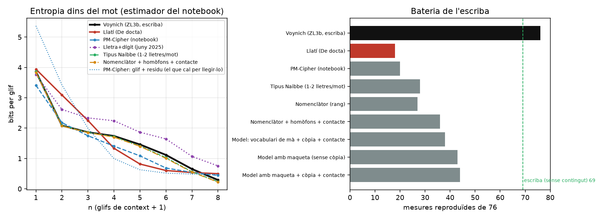

# Xifrats llatí → voynichès: el PM-Cipher refet i què pot fer un xifrat (29–30/10/2026)

> **Resum (30/10).**
> - **§1–2.** El parser del notebook del PM-Cipher tenia errors: els comentaris es tornaven glifs, `<->` enganxava mots, les comes es partien i s'hi barrejaven les etiquetes. Amb les dades netes de l'escriba, H2 = 2,08. El «bump» és un replà de h2 a h5: dins del mot, el Voynich té memòria de dos glifs.
> - **§3.** El PM-Cipher iguala la H2 només perquè posa 10 bits per mot a la nota de residus (20/76). Qualsevol xifrat que escrigui mots del Voynich reprodueix el bump gratis: la corba no distingeix res. Els xifrats «mot a mot» fallen la repetició, les regles de línia i l'ordre dels mots.
> - **§5–6.** El Voynich real costa 0,3–0,45 bits per mot més que l'skribe. El sobrant és lèxic (mots de freqüència mitjana) i segueix la mà, no el tema. Les etiquetes no surten al text de la seva pàgina.
> - **§7.** El xifrat de dues capes (l'skribe condicionat al missatge) es desxifra exacte i fa 74/88 amb 1 lletra per mot (l'skribe sol, 81/88), i 78/88 amb les repeticions com a nul·les. La capacitat va de 2.700 a 7.200 mots llatins a tot el manuscrit. L'ordre dels mots, el forat més gran de l'skribe (0,03 contra 0,088), el xifrat amb llatí l'omple just (0,085). **Però no té la forma d'una seqüència de lletres**: al xifrat, 2 classes de mots ja la recuperen (0,07); al real no (0,012), només a partir de 16 classes. Si hi ha missatge, és un codi de molts símbols (síl·labes o parells de lletres; el tipus Naibbe és el que s'hi acosta més), no un alfabet a una lletra per mot. Si no n'hi ha, és un hàbit de parells de mots que l'skribe no té. La prova que ho decideix és a §7, punt 4. **Feta (§8): l'skribe amb un hàbit de parelles de mots, sense missatge, omple l'ordre dels mots amb la forma del real (res a K=2, ~0,05 a K=32) i manté la bateria. L'explicació més senzilla és un hàbit.**

*Pregunta de quimqu: tornar a fer el PM-Cipher (notebook `pm-cipher.ipynb`, fil 4921 de voynich.ninja, set. 2025) sobre la transliteració del René que fa servir l'escriba, perquè el pas del fitxer al df tenia errors. Després, pensar si hi pot haver algun xifrat que converteixi el llatí en voynichès.*

Fitxers: `lab.py` (dades, entropies, bateria), `pm_cipher_nb.py` (les funcions del notebook copiades tal qual), `ciphers.py` (les famílies de xifrat), `stego.py` (el xifrat «per model»), `corre.py` i `corre2.py` (les dues rondes), `diag_parser.py` (els errors del parser vell), `grafica.py` → `xifrats.png`, `resultats*.json`, `resultats_taula.txt`, `sortides/` (els textos xifrats, amb identificadors de línia del ZL3b). Ronda del 30/10: `xifrat_escriba.py`, `xifrat_extra.py`, `agrega.py`, `ordre.py`, `classes.py`, `sobrant*.py`, `pagines.py`; resultats a `xifrat_escriba_taula.txt`, `xe/`, `xifrat_extra_*.json`, `ordre.json`, `classes.json`, `sobrant*.json`, `pagines.json`.

```bash
cd smileitems/Voynich/novetats/xifrats
PYTHONIOENCODING=utf-8 py -3 diag_parser.py
PYTHONIOENCODING=utf-8 py -3 corre.py      # ~5 min
PYTHONIOENCODING=utf-8 py -3 corre2.py     # ~15 min
PYTHONIOENCODING=utf-8 py -3 grafica.py
PYTHONIOENCODING=utf-8 py -3 sobrant.py ; py -3 sobrant_on.py ; py -3 pagines.py              # §5, §6
PYTHONIOENCODING=utf-8 py -3 xifrat_escriba.py prova                                         # §7: roundtrip curt
PYTHONIOENCODING=utf-8 py -3 xifrat_escriba.py corre <tots|senars> <skribe|1|12> <llavor>    # §7: una llavor -> xe/
PYTHONIOENCODING=utf-8 py -3 agrega.py                                                       # §7: taula
PYTHONIOENCODING=utf-8 py -3 xifrat_extra.py <nulles|nulles2|llengua|sobrant|desxifrat> [senars]
PYTHONIOENCODING=utf-8 py -3 ordre.py ; py -3 classes.py                                     # §7: ordre dels mots
```
L'skribe ve de `C:\devoynich-scribe\scribe` (98ecf31), sense tocar-lo: `xifrat_escriba.py` en reescriu `write()` en memòria.

Dades: Voynich = el de l'escriba (`mesures.load_real`: ZL3b, només text de paràgraf, comes unides, `<->` = espai, 32.284 mots). Text pla = *De docta ignorantia* (el control del 19/10), tallat als mateixos 32.284 mots i abocat a la maqueta real (mateixes línies, pàgines, paràgrafs i forats). El Tirant del notebook no és en aquest PC.



---

## 1 · Què feia malament el parser del notebook

`diag_parser.py` executa el parser del notebook tal qual sobre `ZL3b-n.txt` i el compara amb el df de l'escriba:

- **Comentaris convertits en glifs.** `<!@254;>` i companyia es tornaven caràcters PUA enganxats al mot: 161 mots com `sholdy`. A la secció biològica sortien **33 «glifs» en lloc de 21**.
- **`<->` esborrat sense espai.** Les 758 intrusions de dibuix enganxaven els dos mots del costat.
- **Comes com a espai** (`coma_is_space=True`): 2.748 mots partits. Per això sortien de més `ol`, `y`, `s`, `l`, `or`. L'escriba les uneix.
- **Etiquetes, cercles i radis** dins del corpus (1.029 + 226 loci).
- El notebook mirava **només la secció biològica** (6.317 mots). Ara és tot el text de paràgraf.

Cap d'aquests errors canvia la conclusió de fons, però la corba de referència era una altra: la H2 del Voynich era 1,749 i ara és **2,08**.

## 2 · El «bump», ben definit

Amb l'estimador del notebook (entropia del glif n-è donats els n−1 anteriors, dins del mot, dins de mostra):

| n | 1 | 2 | 3 | 4 | 5 | 6 | 7 | 8 |
|---|---|---|---|---|---|---|---|---|
| Voynich | 3,86 | **2,08** | **1,86** | **1,74** | 1,46 | 1,12 | 0,65 | 0,29 |
| llatí | 3,94 | 3,09 | 2,25 | 1,34 | 0,82 | 0,60 | 0,54 | 0,50 |

El «bump» és el **replà de n = 2 a n = 5**. Al Voynich, saber més d'un glif enrere gairebé no ajuda (2,08 → 1,74). Al llatí sí que ajuda molt (3,09 → 1,34), perquè el mot es reconeix pel començament: és memòria de lèxic. Amb validació a pàgines no vistes (Witten-Bell, amb espais) surt el mateix: el Voynich toca fons a k = 3 (1,93 bits) i el llatí a k = 5 (1,92). **Dins del mot, el Voynich és un procés de memòria curta, de dos glifs.** És el que l'escriba ja feia servir (taula de contacte de dos glifs).

Les dues llengües de Currier tenen el replà (A 2,14 → 1,75; B 1,95 → 1,60).

## 3 · Les famílies de xifrat

| xifrat | H2 | bateria (76) | ordre dels mots (bits) | nota per llegir-lo (bits/mot) |
|---|---|---|---|---|
| Voynich real | 2,08 | 76 | 0,088 | — |
| llatí sense xifrar | 3,09 | 18 | 0,305 | — |
| **PM-Cipher del notebook** | 2,18 | 20 | 0,270 | **10,2** |
| lletra + dígit a l'atzar (juny 2025) | 2,61 | 11 | — | 0 |
| tipus Naibbe (1–2 lletres → 1 mot real) | 2,08 | 28 | 0,062 | 0 |
| nomenclàtor (mot llatí → mot del Voynich pel rang) | 1,96 | 27 | 0,305 | 0 |
| nomenclàtor + homòfons + regla de contacte | 2,07 | 36 | 0,337 | 0 |
| model: vocabulari de mà + còpia + contacte | — | 38 | 0,055 | 0 |
| model amb maqueta (mà × posició a la línia) | — | 43 | 0,121 | 0 |
| **model amb maqueta + còpia + contacte** | — | **44** | 0,058 | 0 |
| *(escriba, sense contingut, 19/10)* | | *69* | | |

Pàgines no vistes (taules apreses dels folis senars, s'escriuen els parells): model amb maqueta 41/76, nomenclàtor 32/76; les dues meitats reals entre elles, 65/76.

### 3.1 · El PM-Cipher: la informació se'n va a la nota

Refet tal qual (mateixa cerca de `target_collision`, mateix escombrat γ/τ), sobre les dades netes, iguala la H2 (2,18 contra 2,08). Però:

- la H1 cau a 3,41 (real 3,86), perquè hi ha menys glifs diferents per posició;
- els residus porten **1,79 bits per glif, 10,2 bits per mot**. El text xifrat en porta 11,8. **Mig missatge viu a la nota de residus.** El flux «glif + residu», que és el que de debò cal per llegir-lo, té la corba del llatí (5,37; 3,42; 1,99; 1,00…), no la del Voynich;
- l'ordre dels mots conserva la sintaxi del llatí (0,270 bits; Voynich 0,088);
- la bateria: 20/76, com el llatí sense xifrar (18/76).

És el que deia nablator al fil: si el xifrat s'assembla al Voynich, els residus porten tanta informació com el text. Ara està mesurat. **Una substitució lletra a lletra no pot canviar la corba sense llençar informació.** Una substitució simple la deixa idèntica (només canvia els noms dels símbols); una de posicional amb molts-a-un la baixa just perquè llença informació, i aquesta informació ha d'anar a algun lloc.

### 3.2 · El «homofònic» de juny de 2025 no fa el bump

Lletra + dígit a l'atzar (0, 1, 2) dona una corba que no s'assembla a la del Voynich amb aquestes dades: és alta pertot (2,61 a n = 2) i no té el replà. El que es veia el juny de 2025 era contra CUVA i amb n fins a 14 dins de mostra. Amb l'EVA net no hi és.

### 3.3 · El bump surt gratis si els mots de sortida són mots del Voynich

Tipus Naibbe, nomenclàtor i nomenclàtor amb homòfons fan la corba del Voynich gairebé exacta, sense cap nota lateral. El motiu és simple: escriuen mots del Voynich, i la corba dins del mot és una propietat **de l'inventari de formes**, no del xifrat. **El bump no distingeix un xifrat d'un text sense contingut, ni el llatí d'una altra llengua.** Només diu que els mots tenen la forma dels mots del Voynich. Les proves que de debò separen són entre mots, a la línia i a la pàgina.

### 3.4 · On fallen els xifrats «mot a mot»

Tots els xifrats que trien el mot de sortida només pel text pla (PM, Naibbe, nomenclàtor) fallen les mateixes famílies de mesures:

- **Repetició.** Al real, el mot repetit just després passa 3,1 vegades més del que tocaria a l'atzar, i els veïns a un glif de distància 2,2 vegades. Als xifrats, 0,1–0,3 i 0,9–1,3. El llatí gairebé no repeteix mots seguits, i un xifrat no s'ho inventa.
- **Posició a la línia i al paràgraf.** Primer mot de línia amb `y-` o `d/s/y-` (real 48%, xifrats 11–18%); gallows al primer mot de paràgraf (93% contra 32–60%); `p/f` a la primera línia; mots tancats a final de línia (27% contra 1–5%); què passa al costat d'un forat de dibuix. Un xifrat que no sap on és a la línia no pot fer res d'això.
- **Ordre dels mots.** El nomenclàtor porta la sintaxi del llatí (0,31–0,34 bits). El Voynich en porta 0,09. Amb homòfons triats a l'atzar no baixa: la informació de la sintaxi és a quin mot llatí hi ha, no a quin homòfon. Només el tipus Naibbe la trenca (0,06), perquè parteix els mots llatins en trossos d'una o dues lletres.
- **Acord de frontera.** La regla de contacte (l'homòfon es tria segons l'últim glif del mot anterior) el puja de 0 a 0,05 bits (real 0,16) i encerta `lift y|q`. És la peça que funciona millor de totes les que s'hi han afegit.

### 3.5 · Qualsevol generador es pot convertir en xifrat: el preu és l'espai

`stego.py` fa servir un model de voynichès com a xifrat. A cada mot, el model dona probabilitats als mots possibles (vocabulari de la mà i de la posició a la línia, còpia dels mots de la pàgina amb variants a un glif, contacte de frontera). Amb aquestes probabilitats es fa un arbre de Huffman, i els bits del llatí trien el camí per l'arbre. Qui té el mateix model refà l'arbre i en recupera els bits: el desxifrat s'ha comprovat. No hi ha cap nota lateral. La sortida és tan voynichesca com ho sigui el model, i l'ordre dels mots queda en 0,06 bits, com al Voynich.

Aquest model és senzill i fa 44/76: el text li surt massa repetitiu (el mot repetit just després, 5,8 contra 3,1), amb massa pocs tipus (3.711 contra 7.915) i sense els hàbits de pàgina. **Però això són defectes del model, no del fet de portar un missatge.** Amb l'escriba (69/76) es pot fer el mateix, i la sortida tindria la qualitat de l'escriba.

**El que costa és l'espai.** El model deixa triar 8,2–8,5 bits per mot. Les lletres llatines amb codi de Huffman costen 4,1 bits cada una, unes 27 bits per mot llatí. Llavors cada mot llatí necessita **3,3 mots del Voynich**, i els 32.284 mots del manuscrit **porten uns 10.000 mots llatins**, una quarta part de *De docta ignorantia*. És el mateix ordre que el tipus Naibbe (1,5 lletres per mot, 8.480 mots llatins).

Com a cota superior: el Voynich real, a pàgines no vistes, costa 13,2 bits per mot amb aquest model (i 13,2 amb un model de caràcters; el llatí, 13,2). Encara que un xifrat aprofités tota l'entropia aparent del text, el manuscrit no podria portar més d'uns 16.000 mots llatins (menys de mig *De docta*) si el llatí s'escriu lletra a lletra. Si el text pla s'escurça abans (abreviatures, només consonants, un nomenclàtor de mots), n'hi cap més.

---

## 4 · Què en traiem

1. **El bump és la forma dels mots, no el xifrat.** Dins del mot el Voynich té memòria de dos glifs. Qualsevol esquema que escrigui mots amb aquest inventari reprodueix la corba; cap substitució lletra a lletra no la reprodueix sense llençar informació a una nota a part. **Com a prova de xifrat, el PM-Cipher queda tancat.**
2. **Hi ha xifrats que fan voynichès a partir del llatí**, i no són impossibles en principi. Un text pla, un vocabulari de formes per mà i posició, i una tria guiada pel missatge donen una sortida que es desxifra i que passa les proves de forma, de frontera i d'ordre dels mots. Però han de tenir tres coses que cap xifrat clàssic no té juntes:
   - **saber on són a la línia i al paràgraf** (taules per mà i posició: unes 13.700 entrades al model);
   - **copiar i variar el que ja és a la pàgina** (la repetició del Voynich no ve del llatí);
   - **ser molt verbosos**: uns 3 mots del Voynich per mot llatí, o el text pla escurçat abans.

   Un xifrat així és, en el fons, **l'escriba amb les tries dirigides pel missatge**. Llavors la pregunta «xifrat o no?» no la poden decidir les estadístiques que hem mirat. Els dos casos donen el mateix text; només canvia d'on surten les tries, d'un dau o d'un missatge.
3. **El que sí que restringeix és l'espai.** Si el Voynich porta un text llatí escrit lletra a lletra, és curt: ~10.000 mots (de 8.500 a 16.000 segons quant s'aprofiti), i es llegiria amb una clau molt gran. Si el text pla anava abreujat o codificat per mots, n'hi cap més, però el nomenclàtor pur deixa la sintaxi del llatí a l'ordre dels mots (0,31 bits contra 0,09), i el Voynich no la té. El que encaixa millor és un **codi per trossos petits (síl·labes o parells de lletres) amb homòfons triats per la posició i el context**: el tipus Naibbe, amb les regles de línia i de còpia de l'escriba a sobre.

### Proves que queden obertes

- Fer el xifrat «per model» amb l'escriba mateix en lloc del model senzill: si dona ~69/76 i porta ~8 bits per mot, l'argument del punt 2 queda demostrat del tot, no només per analogia.
- Tipus Naibbe amb maqueta (homòfons per posició a la línia) i còpia: és el xifrat «d'època» més prometedor, i encara no s'ha provat.
- Repetir-ho amb un llatí més proper al que es podria esperar (herbari, receptari) en lloc de Cusa, que té mots llargs.

---

## 5 · Hi ha informació al Voynich que l'skribe no explica? (`sobrant.py`, `sobrant_on.py`)

*Pregunta: si hi ha un missatge, ha de deixar alguna sorpresa que cap hàbit d'escriptura no faci. Skribe actual de voynich-scribe (98ecf31, bateria de 88).*

**Mètode.** El mateix estimador per a tots els textos: el model s'aprèn de les pàgines de foli senar i es mesura el cost, en bits per mot, de les de foli parell. Es fan servir tres models: de caràcters (Witten-Bell), unigrama de mots, i el model de context de `stego.py` (mà, còpia de la pàgina, contacte).

| text | caràcters | mots | context | tipus (parells) |
|---|---|---|---|---|
| Voynich real | **12,35** | **12,76** | **13,36** | 4.850 |
| skribe, llavors 1–3 | 12,05 · 11,96 · 12,06 | 12,58 · 12,42 · 12,55 | 12,96 · 12,74 · 12,91 | 4.555–4.678 |
| skribe après només dels senars | 11,83 | 12,27 | 12,55 | 4.433 |

El text real costa **0,3–0,45 bits per mot més** que el de l'skribe, un 3%. Les tres llavors de l'skribe es mouen entre elles 0,1–0,2: la diferència és petita, però és real i va sempre en la mateixa direcció.

**Creuat** (model de context):

| | bits/mot |
|---|---|
| après de l'skribe, mesurat sobre un altre skribe | 12,77 |
| après de l'skribe, mesurat sobre el real | **13,75** |
| après del real, mesurat sobre el real | 13,36 |
| après del real, mesurat sobre l'skribe | 12,89 |

Mesurat sobre el real, el model de l'skribe hi perd **1,0 bit per mot** més que sobre un altre skribe. En canvi, el model del real prediu l'skribe millor que el mateix real. **El text de l'skribe és una versió més «típica» del real: el real té alguna cosa de més, i l'skribe no té res que el real no tingui.**

**On viu el sobrant** (cost sota el model de l'skribe menys cost sota el model del real, mot a mot, 0,39 bits/mot de mitjana):

- **Per freqüència del mot.** Els mots de freqüència mitjana (3–20 cops als senars) són el 26% dels mots i fan el **49%** del sobrant (0,74 bits cada un). Els rars (1–2 cops) fan el 24%. Els molt freqüents gairebé no en fan (`>200`: 0,07 bits). Els mots que l'skribe no fa prou són **mots concrets**: `cheeky`, `sheeky`, `orain`, `olkeedy`, `oraiin`, `qotol`, `opchey`, `oteedy`, i també formes freqüents en quantitats concretes (`qokeedy`, `qokedy`). L'skribe les sap escriure, però no les tria tant com el real.
- **Per posició.** Primer mot de paràgraf 0,92, últim de línia 0,67, primera línia 0,64, interior 0,27. Són els registres de línia que l'skribe ja sap que fa a mitges.
- **Per secció.** Pla: entre 0,34 i 0,41 a totes, una mica més al text sol (0,56). No hi ha cap secció on s'amagui.

### Què vol dir, i què no

- **Hi ha un sobrant, i és lèxic.** El Voynich real fa servir mots concrets de freqüència mitjana més del que el procediment de glifs de l'skribe els faria. És la mena de cosa que deixaria un text amb mots que *són* alguna cosa (un vocabulari, noms, termes), o també un hàbit de mot propi de cada escrivà. Aquesta prova no distingeix entre les dues coses. La N2 del registre (cap preferència pròpia de mot que l'skribe no tingui ja, mà × secció) apunta més aviat a la segona, però allà es mirava una altra cosa.
- **És petit.** Un 3% del cost per mot, ~0,4 bits; com a molt 1 bit si es mesura amb el model de l'skribe. Si fos tot missatge, serien 13.000 bits per tot el manuscrit, uns 500 mots llatins lletra a lletra. **Però no és una cota per al missatge**, i ho he de corregir de la resposta d'abans. Un xifrat ben fet com el de §3.5 posa el missatge *dins de les tries que l'skribe fa a l'atzar* (12,5 bits per mot de daus) i no deixa cap sobrant. Aquesta prova no veu un missatge amagat així. Només veu estructura que el procediment no fa. El que diu és:
  1. el text real és tan imprevisible com el de l'skribe, no més (± 3%);
  2. si porta un missatge, o el porta a les tries «lliures» del procediment, sense que es noti a cap estadística local, o en porta molt poc;
  3. el poc que sobra són mots concrets. És el lloc on buscar contingut, si n'hi ha: quins mots de freqüència mitjana fa servir cada pàgina més del que tocaria, i si coincideixen amb el dibuix. Els rastres de Schwartz (etiquetes, tint de tema de 0,2–0,3 bits per pàgina) són del mateix ordre de mida.

---

## 6 · El sobrant, pàgina a pàgina: tema o mà? (`pagines.py`, `pagines_out.txt`)

*Continuació de §5. Si els mots de freqüència mitjana que l'skribe no fa prou fossin contingut, cada pàgina n'hauria de fer servir més dels del seu tema, i les pàgines del mateix tema (secció, dibuix) els haurien de compartir encara que les escrigui una altra mà. Mots de freqüència mitjana: entre 5 i 50 cops al text sencer. Real contra skribe (98ecf31), 3 llavors.*

**A · Concentració per pàgina.** Índex de dispersió dels mots de freqüència mitjana entre les pàgines d'un mateix grup mà × secció (1 = repartits a l'atzar):

| text | mitjana | mediana |
|---|---|---|
| Voynich real | **1,27** | 1,11 |
| skribe, llavors 1–3 | 1,24 · 1,28 · 1,25 | 1,10–1,15 |
| Voynich barrejat dins de mà × secció | 1,01 | 0,96 |
| *llatí (De docta), pàgines de la maqueta* | *1,53* | *1,29* |
| *llatí barrejat* | *1,00* | *0,97* |

El Voynich concentra mots per pàgina (1,27 contra 1,01 barrejat), però **l'skribe ho fa exactament igual**, sense cap contingut: és la còpia dins de la pàgina i els hàbits de full. El llatí, que té tema, en concentra el doble (1,53).

**B · Amb qui comparteix mots clau una pàgina** (cosinus TF-IDF dels mots de freqüència mitjana, parelles de pàgines de fulls diferents):

| | real | skribe (3 llavors) |
|---|---|---|
| mateixa mà, mateixa secció | 0,075 | 0,077–0,081 |
| **mateixa mà, altra secció** | **0,055** | 0,053–0,058 |
| altra mà, altra secció | 0,046 | 0,048–0,050 |
| **altra mà, mateixa secció** | **0,027** | 0,027–0,030 |

Els mots clau segueixen **la mà, no el tema**. Dues pàgines de la mateixa mà i de seccions diferents (per exemple, l'herbari i la farmacèutica de la mà 1) comparteixen el doble que dues pàgines de la mateixa secció i de mans diferents (l'herbari de la mà 1 i el de la mà 2). Aquestes últimes en comparteixen fins i tot menys que dues pàgines que no tenen res en comú. I l'skribe dona la mateixa taula xifra a xifra.

**C · Les etiquetes del dibuix al text de la seva pàgina** (560 mots d'etiqueta de 3 glifs o més; per comparar, el text d'una pàgina d'una altra secció del mateix tipus, d'un altre full, 200 vegades):

| | a la seva pàgina | a una altra pàgina de la secció | skribe: pròpia − altra |
|---|---|---|---|
| el mateix mot | 9,3% | 8,2% | −0,1 · +1,3 · +0,3 |
| a un glif | 41,1% | 38,8% | −1,3 · −4,0 · +0,1 |

La diferència del real (+1,0 i +2,3 punts) és dins del soroll: l'error típic és d'uns 2 punts, i l'skribe, que no sap res de les etiquetes, dona diferències de la mateixa mida. **Les etiquetes no surten més al text de la seva pàgina que al de qualsevol altra pàgina de la mateixa secció.**

### Què en traiem

- **El sobrant lèxic de §5 no és de pàgina ni de tema.** L'skribe ja reprodueix com es concentra a la pàgina (A) i com es comparteix entre pàgines (B). El que no fa prou és la quantitat global de certs mots concrets. Això és un vocabulari preferit, més propi d'un hàbit de mà (B: la mà mana) que d'un contingut.
- **Un text amb tema ho faria diferent.** Concentraria més per pàgina (el llatí, el doble), compartiria mots entre pàgines del mateix tema encara que fossin de mans diferents, i les etiquetes del dibuix sortirien al text del costat. El Voynich no fa cap de les tres coses.
- Amb el que tenim, doncs, **no hi ha cap rastre de contingut lligat al dibuix ni al tema que el procediment de l'skribe no expliqui**. L'única porta que no es pot tancar per estadística és la de §5: un missatge amagat a les tries a l'atzar del procediment. Seria un xifrat de capacitat petita, amb una clau enorme, i no hauria deixat cap signe de tema enlloc.
- Límit de la prova: «tema» és la secció, no la planta concreta. Una prova planta a planta (herbari ↔ farmacèutica amb el mateix dibuix) necessitaria una llista de parelles identificades que ara no tenim.

---

## 7 · El xifrat de dues capes, fet amb l'skribe (`xifrat_escriba.py`, `xifrat_extra.py`, `agrega.py`, `ordre.py`, `classes.py`)

*30/10/2026. La proposta de la resposta del 29/10: el text pla es talla en trossos d'una o dues lletres; cada tros és una classe de mots; l'skribe escriu com sempre, i a cada mot només s'accepta la seva tria si cau a la classe que toca. És l'skribe condicionat al missatge.*

**Com està fet.**
- **Capa de xifrat.** La classe d'un mot es llegeix de la seva forma sense la capa d'escrivà: es desfà el tancament (`-m` → `-iin`/`-in`, `-ly` → `-l`, `-ry`, `-sy`, `-g` → `-y`), `p/f` → `k/t` i es treu la `q-`. Una taula reparteix les formes reals entre les unitats del text pla per massa (cada lletra rep formes que, juntes, pesen al Voynich el que pesa la lletra al llatí). Les formes noves van per una regla fixa.
- **Capa d'escrivà.** És l'skribe sencer de voynich-scribe (98ecf31): còpia, contacte, mans, fulls, registres de línia i tancaments. `write()` es reescriu automàticament amb un bucle de reintents al voltant de cada mot (400 intents; 3.000 per a les unitats de dues lletres). Si no n'encerta cap, posa un mot real de la classe que toca.
- **Desxifrat.** Mot a mot amb la taula, sense cap nota. **Comprovat sobre el manuscrit sencer: les 32.284 unitats tornen exactes**, amb 1 lletra per mot i amb 1–2 lletres per mot (`xifrat_extra_desxifrat.json`). Pel camí s'han trobat i arreglat dos errors de normalització: `oly` tancat en `olg`, i els mots d'un glif `r`/`s` tancats en `ry`/`sy`.

**Resultat** (bateria de 88 de voynich-scribe, 3 llavors per fila; «pàgines no vistes» = après dels senars, escriu els parells, comparat amb els parells reals; sostre entre meitats reals 78/88):

| | text sencer | pàgines no vistes | bits/mot | mots llatins al manuscrit | ordre dels mots |
|---|---|---|---|---|---|
| skribe, sense missatge | **81/88** | **75/88** | 0 | 0 | 0,032 |
| xifrat, 1 lletra per mot | **74/88** | **70/88** | 3,96 | 4.800 | 0,085 |
| xifrat, 1–2 lletres per mot | 65/88 | 62/88 | 6,59 | 7.200 | 0,100 |
| xifrat, 1 lletra, repeticions nul·les (totes) | 56/88 | 46/88 | 0,81 | 990 | — |
| xifrat, 1 lletra, repeticions nul·les (racionades) | **78/88** | 69/88 | 2,2 | 2.700 | 0,037 |
| xifrat, 1–2 lletres, repeticions nul·les (racionades) | 61/88 | 60/88 | 2,7 | 3.000 | 0,046 |
| *Voynich real* | | | | | *0,088* |

**Què perd el xifrat respecte de l'skribe sol** (1 lletra per mot, text sencer; detall a `xifrat_escriba_taula.txt`):
- **la repetició immediata**: mots iguals seguits, 0,15% contra 0,90% real. Repetir un mot vol dir repetir la unitat del missatge, i el llatí no repeteix gaire la mateixa lletra;
- els veïns a un glif de distància (1,36 contra 1,97);
- la `q-` al primer mot de paràgraf, la `a-` a inici de línia, i la sobredispersió per pàgina dels mots freqüents (1,52 contra 2,06).

Tota la resta (forma dels mots, frontera, línia, paràgraf, full, abast llarg, ull) s'aguanta. **Amb 1 lletra per mot, el missatge costa 7 mesures de 88.** Amb 1–2 lletres en costa 16: les classes són més petites, l'skribe ha d'insistir molt (316 intents per mot de mitjana), i un 2,5% dels mots són de reserva.

**Les repeticions com a nul·les.** Si les repeticions de la pàgina no porten res (el lector se les salta), el xifrat recupera la repetició. Però si se n'accepten totes, l'skribe hi cau sempre: el 80% del text surt nul (real: el 34% dels mots repeteixen una forma ja escrita a la pàgina). Racionades, és a dir, acceptades amb la mateixa probabilitat que un mot que porta missatge, surt un 45% de nuls i **78/88**, a 3 mesures de l'skribe. Però la capacitat cau a 2,2 bits per mot, i al manuscrit només hi caben ~2.700 mots llatins.

**La llengua de sota** (1 lletra per mot, text sencer, 3 llavors):

| text pla | bateria | ordre dels mots |
|---|---|---|
| llatí | 75/88 | **0,089** |
| vietnamita (VIQR) | 77/88 | 0,167 |
| xinès (pinyin) | 74/88 | 0,312 |
| lletres a l'atzar amb les freqüències del llatí | 77/88 | 0,021 |
| lletres a l'atzar uniformes | 74/88 | 0,017 |

La bateria no veu la llengua: totes queden entre 74 i 77. **L'ordre dels mots sí que la veu**: el xifrat passa a l'ordre dels mots la dependència entre lletres seguides del text pla. Les síl·labes curtes i molt repetides del vietnamita i del pinyin en porten el doble i el quàdruple que el llatí.

### L'ordre dels mots: l'únic forat de l'skribe que un missatge omple (post hoc)

`ordre.py`: informació entre mots seguits de la mateixa línia (els 200 més freqüents), menys la del mateix text amb els mots barrejats dins de la línia. És la mesura dels controls del 19/10.

| | sencer | sense parells iguals | sense parells a un glif |
|---|---|---|---|
| Voynich real | **0,088** | 0,085 | 0,081 |
| real, només senars · només parells | 0,081 · 0,082 | 0,079 · 0,079 | 0,078 · 0,078 |
| skribe, 3 llavors | 0,028 · 0,034 · 0,034 | 0,029–0,034 | 0,030–0,034 |
| **xifrat amb llatí, 3 llavors** | **0,086 · 0,088 · 0,082** | 0,081–0,087 | 0,077–0,083 |
| xifrat amb lletres a l'atzar, 3 llavors | 0,023 · 0,027 · 0,022 | 0,022–0,027 | 0,021–0,027 |

- L'skribe en fa **un terç** del que té el real (ja es veia als controls del 19/10: 0,082 → 0,036). És la mesura on l'skribe falla més de lluny.
- **No ve de les repeticions.** Treient els parells iguals o a un glif, el real es queda en 0,081. I és estable entre meitats.
- **Un missatge de lletres llatines l'omple exactament** (0,082–0,088). El mateix xifrat amb lletres a l'atzar no (0,022–0,027): el que hi posa la informació és la seqüència del text pla, no el xifrat.
- **El sobrant de §5 va en la mateixa direcció.** Amb el mateix estimador, portar un missatge fa pujar el cost per mot de l'skribe cap al del real:

  | | caràcters | context |
  |---|---|---|
  | skribe | 12,03 | 12,87 |
  | xifrat, 1 lletra | 12,19 | 13,03 |
  | xifrat, 1–2 lletres | **12,51** | **13,40** |
  | real | **12,35** | **13,36** |

**Compte.** Això és post hoc, i hi ha altres maneres de posar informació entre mots seguits sense que hi hagi cap missatge: un hàbit de parells de mots, una memòria de mot a mot que l'skribe no té (només té memòria de glif a la frontera), o fórmules. Que el llatí doni just la xifra del real pot ser casualitat: el vietnamita en dona el doble, i un text pla escurçat o una altra mida d'unitat en donarien una altra. El que sí que diu és que **l'únic gran forat de l'skribe és del tipus i de la mida que deixaria un missatge escrit a 1 lletra per mot**, i que la resta de proves no ho contradiu.

### Té forma de seqüència de lletres? No (`classes.py`)

Agrupament de mots per intercanvi (Kneser-Ney): K classes que maximitzen la informació entre la classe d'un mot i la del següent. S'aprèn dels folis senars (els 600 mots més freqüents) i es mesura als parells, menys la dels parells amb els mots barrejats dins de la línia:

| K classes | 2 | 4 | 8 | 16 | 24 | 32 |
|---|---|---|---|---|---|---|
| Voynich real | 0,012 | 0,014 | 0,027 | 0,052 | 0,056 | 0,054 |
| skribe, 2 llavors | 0,002–0,003 | 0,004–0,007 | 0,002–0,009 | 0,006–0,012 | 0,012–0,018 | 0,007–0,028 |
| xifrat amb llatí, 2 llavors | **0,072–0,075** | 0,11–0,12 | 0,10–0,15 | 0,11–0,12 | 0,12–0,15 | 0,13 |
| xifrat amb lletres a l'atzar | 0,001 | 0,000 | 0,001 | 0,004 | 0,000 | 0,004 |
| tipus Naibbe (§3: 1–2 lletres → mot real, sense skribe) | 0,027 | 0,048 | 0,053 | 0,060 | 0,058 | 0,050 |
| nomenclàtor + homòfons + contacte (§3: mot llatí → mot) | 0,025 | 0,065 | 0,147 | 0,179 | 0,214 | 0,247 |

Al xifrat amb llatí, la informació d'ordre es recupera gairebé tota amb **dues classes**. L'agrupament troba sol l'alternança de vocals i consonants del text pla, i amb poques classes més arriba a 0,12–0,15, molt per sobre del real. **Al real no hi ha res d'això**: amb 2 classes, 0,012; la informació només apareix a partir de 16 classes, i no passa de 0,056. És informació de parells de mots concrets, que no es deixa resumir en poques classes, no la d'una seqüència de símbols d'un alfabet. L'skribe en fa una quarta part.

Les dues famílies de §3 que tenen més símbols queden a banda i banda. El **nomenclàtor**, amb un mot llatí per mot, en té massa, i creix sense parar amb K: és la sintaxi del llatí. El **tipus Naibbe**, amb trossos aleatoris d'1–2 lletres, és el que més s'hi acosta: arriba a una mida semblant al real a K ≥ 8 (0,05–0,06). Però a K petit encara en té el doble o el triple (0,027–0,048 contra 0,012–0,014), perquè les lletres hi continuen passant d'un mot al següent.

**Conclusió de §7.**
1. **El xifrat de dues capes existeix i funciona.** Es desxifra exacte, i amb 1 lletra per mot el missatge només costa 7 mesures de 88 a l'skribe (74/88; a pàgines no vistes, 70 contra 75). Amb les repeticions com a nul·les, 78/88. Com a demostració, és el que prometia §4: les estadístiques que tenim no poden descartar que el Voynich porti un text així.
2. **El preu és el que dèiem**: 2–7 bits per mot, de 2.700 a 7.200 mots llatins a tot el manuscrit. La fidelitat i la capacitat van una contra l'altra.
3. **On el Voynich és diferent de l'skribe** (ordre dels mots, sobrant de §5), un missatge hi va en la direcció bona i amb la mida bona. Però **la forma no hi encaixa**: la informació entre mots del real no té l'estructura de pocs símbols que deixa un text alfabètic llegit lletra a lletra, i l'agrupament ho veu de seguida. Si el Voynich porta un missatge, no és un alfabet escrit a una lletra per mot amb homòfons repartits per massa. Hauria de ser un codi de **molts símbols**: unitats més grosses que la lletra, com síl·labes o parells de lletres, però no mots sencers, que portarien la sintaxi. O bé un missatge sense estructura interna visible. O bé no n'hi ha, i el que l'skribe no fa és un hàbit de parells de mots de l'escrivà.
4. **Següent prova natural** (no feta): afegir a l'skribe una memòria de mot a mot (parells de mots que s'atreuen) sense cap missatge. Si omple l'ordre dels mots amb la forma del real (res a K=2, ~0,05 a K≥16), el forat era un hàbit. Si no, un codi de molts símbols passa a ser el millor candidat i s'ha de provar amb síl·labes llatines com a unitats.

---

## 8 · La prova de §7.4: l'skribe amb memòria de mot a mot, sense missatge (`memoria_mots.py`, `mm/`)

*30/10/2026. Si el forat de l'ordre dels mots és un hàbit de l'escrivà, un skribe que encadeni parelles de mots, sense cap missatge, l'ha d'omplir **amb la forma del real**: res amb 2 classes i ~0,05 a partir de 16.*

**Com està fet.** De les línies dels folis **senars** del real es treuen les parelles de mots seguits que s'atreuen: vistes 3 cops o més i amb una PMI d'1 bit o més, sense parelles iguals ni a un glif (això ja és la còpia de l'skribe). Surten 162 parelles de 60 mots (taula «estreta»); amb 2 cops i 0,5 bits, 627 (taula «ampla»). L'skribe (98ecf31) escriu com sempre. A cada mot que no és el primer de la línia, si el mot anterior té parelles apreses, amb probabilitat λ «segueix l'hàbit»: torna a triar fins que el mot fa parella amb l'anterior (fins a 200 intents). La λ es calibra perquè l'ordre dels mots arribi al del real: λ = 0,13. Al final l'hàbit només actua en el **3,5–5% dels mots**. El que es prova és la forma, amb el mateix agrupament de §7: s'aprèn dels senars del mateix text i es mesura als parells.

| | ordre (sencer · parells) | K=2 | 4 | 8 | 16 | 32 | bateria |
|---|---|---|---|---|---|---|---|
| Voynich real | 0,088 · 0,082 | **0,012** | 0,014 | 0,027 | **0,052** | 0,054 | — |
| skribe sol, 2 llavors | 0,028–0,034 · 0,030–0,033 | 0,002–0,003 | 0,004–0,007 | 0,002–0,009 | 0,006–0,012 | 0,007–0,028 | 81 · 75 |
| **skribe + parelles (estreta), 2 llavors** | 0,078–0,083 · 0,071–0,075 | **0,001–0,004** | 0,004–0,008 | 0,012–0,025 | 0,025–0,033 | 0,041–0,044 | 79 · 74 |
| **skribe + parelles (ampla), 2 llavors** | 0,082–0,087 · 0,071–0,073 | **0,007–0,010** | 0,010–0,013 | 0,014–0,024 | 0,032–0,035 | 0,045–0,055 | 77 · 77 |
| *xifrat amb llatí (§7)* | *0,082–0,088* | *0,072–0,075* | *0,11–0,12* | *0,10–0,15* | *0,11–0,12* | *0,13* | *74* |

- **Omple el forat sense cap missatge.** Amb l'hàbit, l'ordre dels mots passa de 0,03 a 0,08, també als folis parells, on les parelles no s'han après del text real.
- **I l'omple amb la forma del real.** Amb 2 classes no hi ha res (0,001–0,010, real 0,012; el xifrat amb llatí, 0,072). La informació creix a poc a poc amb el nombre de classes i a K=32 arriba al real (0,041–0,055 contra 0,054). A K=16 queda una mica per sota (0,025–0,035 contra 0,052).
- **No costa res a la bateria** (74–79/88, l'skribe sol 75–81). Les mesures que falla canvien d'una llavor a l'altra, com les de l'skribe sol.

**Què en traiem.** L'únic gran forat de l'skribe, l'ordre dels mots, s'explica amb un hàbit petit: encadenar unes desenes de parelles de mots concretes, en un 4–5% dels mots. No cal cap missatge. A més, la forma que deixa és la del real, i la d'un alfabet xifrat no. Amb això, l'argument de §7 a favor d'un missatge, que era el que omplia aquest forat, perd la força: **l'explicació més senzilla és un hàbit de parells de mots**. Un codi de molts símbols no queda descartat, però ja no cal per explicar res del que hem mesurat.

**Límits.** Les parelles s'aprenen del real (dels senars): l'skribe aprèn *quines* parelles fa l'escrivà, no *per què*. Si les parelles fossin trossos d'un missatge, aquesta prova no ho veuria. Són 2 llavors per variant, i la λ és un sol paràmetre calibrat a l'ordre total.

---

## 9 · Parelles, trios i quatriots (`ngrames.py` → `ngrames.txt`, `ngrames.json`)

*30/10/2026. Quines seqüències de 2, 3 i 4 mots seguits de la mateixa línia escriu el Voynich més sovint del que tocaria si els mots de cada línia anessin en qualsevol ordre (300 barreges dins de la línia)?*

**Quantes seqüències es repeteixen** (diferents que surten 2 cops o més; entre parèntesis, 3 o més):

| text | 2 mots | 3 mots | 4 mots | 5 mots |
|---|---|---|---|---|
| Voynich real | 1.748 (634) | **94 (7)** | **1 (0)** | **0** |
| llatí, *De docta ignorantia* a la mateixa maqueta | 3.173 (1.371) | 745 (189) | 131 (11) | 20 |
| skribe sol, 3 llavors | 1.609–1.685 | 21–51 | 0–1 | 0 |
| skribe + hàbit de parelles (§8) | 1.643 (599) | 100 (15) | 4 | 0 |

- **El Voynich gairebé no repeteix frases.** En 32.284 mots, només 94 trios surten dues vegades, i 7 tres vegades. Només hi ha un quatriot repetit (`ol shedy qokedy qokeedy`, 2 cops, totes dues a la secció biològica), i cap seqüència de cinc mots. El llatí, amb el mateix nombre de mots, repeteix 8 vegades més trios i 131 quatriots.
- **Els trios que hi ha els explica l'hàbit de parelles.** L'skribe amb les 162 parelles de §8, i sense res més, fa tants trios repetits com el real (100 contra 94) i més quatriots (4 contra 1). No cal cap memòria de més de dos mots.

**Parelles** (descobertes als folis senars amb p ≤ 0,01, confirmades als parells amb p ≤ 0,05): 34 per sobre de l'atzar i **15 confirmades**.
- Tres són `s aiin`, `or aiin` i `r aiin` (25, 26 i 9 cops; 6–8 vegades l'atzar, a 8–24 pàgines). Gairebé segur que són un sol mot partit per un espai dubtós (`saiin`, `oraiin`, `raiin`): és la transcripció, no una frase.
- La resta són de la llengua B, sobretot de la mà 2 a la secció biològica (`qol chedy`, `shedy qokaiin`, `chedy qokain`, `sheedy qokeedy`, `qokain chckhy`) i de la mà 3 a les estrelles (`chedy qokeey`, `otar ar`). Són 2–4 vegades l'atzar. També hi ha `daiin dam` (mà 1, herbari) i `aiin okal`.
- L'skribe ja en fa una part (x1–4) amb la regla de contacte entre el final d'un mot i el començament del següent. El real en fa més.

**Trios**: 71 per sobre de l'atzar, 35 a totes dues meitats del manuscrit, cap més de 3 cops. La majoria són dues parelles atretes encadenades, a la mateixa mà i secció, sovint a la mateixa pàgina o al mateix full. La xifra de «cadena» (observat contra el que donarien les parelles) surt alta, però està inflada: es tria precisament els trios que es repeteixen, i amb 2 cops qualsevol cadena de parelles rares en dona molt més del que s'espera. La prova neta és la de dalt: l'hàbit de parelles sol ja dona el mateix nombre de trios.

**Contra textos coneguts** (`frases_controls.py`, `frases_quasi.py`; 32.284 mots de cada text abocats a les llargades de línia del Voynich; Project Gutenberg). Seqüències diferents que surten 2 cops o més:

| text | tipus | 3 mots | 4 mots | 5 mots | trios quasi repetits* |
|---|---|---|---|---|---|
| **Voynich real** | 7.915 | **94** | **1** | **0** | 19,0% |
| Apicius, receptari llatí (27.767 mots) | 4.943 | 1.162 | 509 | 204 | 25,0% |
| *Forme of Cury*, receptari anglès c. 1390 | 4.795 | 1.800 | 712 | 215 | — |
| Culpeper, herbari anglès 1652 | 3.248 | 1.806 | 647 | 221 | 27,9% |
| Quixot | 5.508 | 988 | 183 | 33 | — |
| *Promessi sposi* (el text amb menys repetició) | 7.790 | 424 | 58 | 15 | 9,3% |
| *Divina Commedia* (vers) | 6.329 | 541 | 56 | 7 | 16,5% |
| *De docta ignorantia* | 5.972 | 745 | 131 | 20 | 10,5% |
| xifrat nomenclàtor + homòfons + contacte (§3) | 5.591 | 556 | 80 | 15 | 16,9% |
| xifrat tipus Naibbe, 1–2 lletres per mot (§3) | 5.809 | **35** | **1** | **0** | 8,2% |
| skribe sol | 7.525 | 21–51 | 0–1 | 0 | 15,4–17,5% |
| skribe + hàbit de parelles (§8) | — | 100 | 4 | 0 | 20,1–21,0% |

\* trios que tenen un «bessó» en una altra línia amb cada mot igual o a una lletra de distància.

- **Les fórmules d'un receptari o d'un herbari** són exactament el que el Voynich no té: *ut ferveat cum ferbuerit* (18 cops a Apicius), *and serue it forth* (29 a la *Forme of Cury*), *government and virtues* (57 a Culpeper). Fins i tot el text més variat de la mostra, una novel·la italiana amb tants tipus de mot com el Voynich, repeteix 424 trios i 58 quatriots.
- **Un xifrat mot a mot també les repeteix**, encara que tingui homòfons (556 trios): la frase del text pla torna i el xifrat la torna a escriure. Només els esquemes que no escriuen mots del text pla, com el tipus Naibbe (lletres o trossos de lletres → mot) o l'skribe, fan tan poques frases com el Voynich.
- **Amb frases «quasi» iguals la diferència desapareix, però no vol dir res**: el Voynich arriba al 19%, com Dante o Apicius. Ara bé, l'skribe, que no té cap frase, ja en fa el 15–17%, perquè els mots del Voynich s'assemblen tant entre ells (`chedy`, `shedy`, `qokedy`, `okedy`) que qualsevol trio té un quasi bessó. Amb l'hàbit de parelles, 20–21%: tot el que el Voynich fa de més ho explica l'hàbit.
- **Llengües sense articles** (`frases_sense_articles.py`). Els articles i les preposicions fan bona part de les frases repetides, i hi ha llengües que no en tenen o que els enganxen al mot. Sense articles, la xifra baixa, però no fins al Voynich. Una novel·la finesa (*Seitsemän veljestä*), amb més formes de mot que el Voynich (11.036 tipus contra 7.915), repeteix 309 trios, 88 quatriots i 30 seqüències de cinc mots. *Pan Tadeusz*, en polonès, en repeteix 192, 73 i 37, i el llatí d'Apicius i de Cusa, 1.162 i 745 trios. El Voynich: 94, 1 i 0. Si es treuen de cada text els 100 mots més freqüents (més o menys, els mots gramaticals), el Voynich i la *Divina Commedia* queden tots dos a 0 trios. Aquesta versió, doncs, no distingeix res. On la diferència és més clara és a 4 i 5 mots: tots els textos de la mostra en repeteixen desenes, i el Voynich, 1 i 0.
- **Límit:** un codi mot a mot amb molts homòfons per mot (desenes) o una ortografia molt variable també trencaria les repeticions exactes. Aquesta prova no ho descarta.

**Què en traiem.** El Voynich té un hàbit de parelles de mots: poques desenes de parelles, pròpies de cada mà i secció, sobretot a la llengua B. Més enllà de dos mots no hi ha res: ni fórmules, ni frases fetes, ni seqüències que tornin. Els herbaris i els receptaris que s'hi podrien assemblar pel contingut en tenen centenars, i els xifrats mot a mot també. El que encaixa amb les dades és un escrivà que encadena mots de dos en dos, o un xifrat que no escriu els mots del text pla un per un (§7). Una llengua escrita mot a mot només hi encaixaria amb una clau de molts homòfons per mot o una ortografia que mai no repeteix la mateixa frase igual.

---

## 10 · Una llengua amagada síl·laba a síl·laba (`sil/sillabes.py`, preregistre `sil/SILLABES_PREREG.md`, sortida `sil/sillabes.txt`)

*30–31/10/2026, preregistrada abans de córrer res. És la prova que quedava oberta a §7 (punt 3): si el Voynich porta un missatge, hauria de ser un codi de molts símbols. La candidata natural és la síl·laba.*

**Com està fet.** El mateix xifrat de dues capes de §7, amb síl·labes com a unitats en lloc de lletres. Síl·labes per regla fixa (V-CV, VC-CV, muta cum liquida junta, `qu` consonant, `ae au oe` un sol nucli), amb la final de mot marcada (`ta` ≠ `ta#`) perquè el lector recuperi els límits de mot. Les 300 síl·labes més freqüents són unitats pròpies i la resta va lletra a lletra: 319 classes. 3.000 intents per mot. Text pla: llatí (*De docta ignorantia*) i italià (*Pinocchio*, sense accents). 3 llavors al text sencer i 3 a pàgines no vistes. El desxifrat torna les unitats exactes a totes 12. (Les passades del text sencer van petar dues vegades al final per imports que faltaven; la segona vegada el text ja s'havia desat i es va mesurar amb `sillabes.py acaba`, sense tornar-lo a escriure. Per això no hi ha intents ni mots de reserva del text sencer; a pàgines no vistes, ~445 intents per mot i un 4% de reserva.)

| | bateria (sencer · no vistes) | ordre | K=2 | K=32 | trios · 5 mots repetits | mots del text pla |
|---|---|---|---|---|---|---|
| criteri | ≥ 74 · ≥ 70 | 0,06–0,12 | ≤ 0,025 | 0,03–0,08 | ≤ 190 · ≤ 2 | |
| Voynich real | — | 0,088 | 0,012 | 0,054 | 94 · 0 | |
| skribe sol | 81 · 75 | 0,03 | 0,002 | 0,007–0,028 | 21–51 · 0 | 0 |
| skribe + hàbit de parelles (§8) | 77–79 · 74–77 | 0,08 | 0,001–0,010 | 0,041–0,055 | 100 · 0 | 0 |
| xifrat d'1 lletra per mot (§7) | 74 · 70 | 0,085 | 0,072 | 0,13 | — | 4.800 |
| **síl·labes, llatí** | **62 · 55** | **0,30** | **0,059** | **0,45** | **437 · 7** | 11.200 |
| **síl·labes, italià** | **59 · 55** | **0,19** | **0,072** | **0,31** | **256 · 5** | 12.800 |

**Criteris: C1, C2, C3 i C4 fallen tots quatre, amb totes dues llengües.** Segons la lectura acordada (falla C2 o C4), **el codi de síl·labes deixa un rastre que el Voynich no té, i perd.** No és qüestió de la llengua: el llatí i l'italià fallen igual.

- **L'ordre dels mots, el triple o el doble del real.** Cada mot és ara una síl·laba, i les síl·labes d'un mateix mot del text pla estan molt lligades entre elles. A més, amb 2 classes ja se'n recupera gairebé tant com amb l'alfabet (0,06–0,07): la frontera de mot del text pla (`#`) fa el paper de l'alternança vocal–consonant.
- **Frases repetides.** Les síl·labes del text pla tornen en el mateix ordre (`-tur`, `-que`, `in-`, `con-`...), i el xifrat ho copia: 437 trios i 7 seqüències de cinc mots repetides, contra 94 i 0 al real.
- **La bateria baixa molt més que amb l'alfabet** (62 i 59 contra 74). Amb 319 classes, cada mot ha de caure en una classe petita, i el missatge mana la tria per sobre de l'hàbit de pàgina: cauen les repeticions (mots iguals seguits 0,06–0,26% contra 0,9%), el vocabulari compartit entre pàgines veïnes, la sobredispersió dels mots freqüents per pàgina i les diferències de secció.
- **La capacitat és la que esperàvem**: 7,4 bits per mot, 11.000–13.000 mots del text pla a tot el manuscrit, més que qualsevol variant de §7. És precisament el que es paga.

**Què en traiem.** Amb §7 i §9, el patró és el mateix per a tres mides d'unitat (lletra, síl·laba, mot sencer): **una llengua natural escrita en ordre, unitat a unitat, passa a l'ordre dels mots del xifrat una estructura que el Voynich no té**, i amb unitats grosses també les seves frases. El Voynich gairebé no porta informació a l'ordre dels mots més enllà d'unes desenes de parelles, i això ho fa l'hàbit de parelles de §8 sense cap missatge.

**Què no descarta.** Un sistema que «blanquegi» la seqüència del text pla abans de convertir-la en mots: taules que canvien amb la posició o amb una clau, unitats tallades a l'atzar que no coincideixen amb síl·labes ni amb mots (el tipus Naibbe de §3 fa 35 trios repetits i el K=2 més baix de les famílies amb missatge, 0,027), o un missatge comprimit o sense estructura. Si el Voynich porta una llengua, ha d'estar amagada amb un d'aquests sistemes, i a dins de cada mot, no a la seqüència. La pregunta ja no és «quin alfabet» sinó «quin procediment del segle XV esborra l'ordre del text pla», i l'explicació sense missatge no necessita cap procediment.
